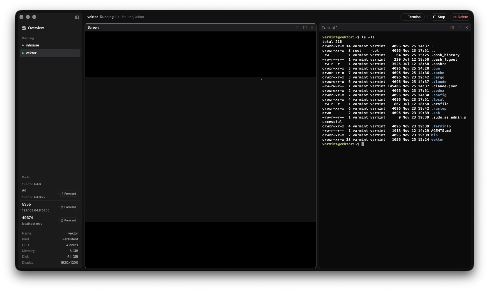

<p align="center">
  
</p>

<h1 align="center">vm</h1>

<p align="center">
  <strong>Disposable Linux VMs for coding agents.</strong><br>
  A clean Linux machine in a second.
</p>

<p align="center">
  <a href="https://github.com/luckydye/vm/releases/latest"></a>
  <a href="docs/getting-started.md#macos"></a>
  <a href="docs/getting-started.md#linux"></a>
  <a href="docs/screen.md"></a>
  
</p>

<p align="center">
  
</p>

`vm` starts a Debian desktop VM and deletes it when it stops. You drive it from the CLI: shells, commands, SSH, file sharing, screen and input. There is no network setup, no image management, and no cloud.

```sh
vm=$(vm run --seed .:work --wait-network)     # a copy of this repo at ~/work
vm run $vm -- sh -c 'cd work && exec claude'  # Claude Code inside
vm pull $vm                                   # its commits come back as $vm/BRANCH
vm stop $vm                                   # the VM and its disk are deleted
```

## Features

- **Starts in about a second.** `vm run` clones the base image with copy-on-write. The first run unpacks it; later runs take milliseconds.
- **Deleted when you stop.** `vm stop` deletes the VM and its disk. `--persist` keeps a named VM across restarts.
- **Choose how files enter.** `--seed` copies a directory into the VM one way. `--mount` shares a host directory live. Seeds suit agents, mounts suit working in the VM yourself.
- **The tools are preinstalled.** Debian, mise, Claude Code, OpenCode, passwordless `sudo` and podman are in the base image. Agent tokens come from your shell, never as arguments.
- **Commits come back as branches.** `vm pull $vm` fetches the VM's branches into your repo as `$vm/BRANCH`. You review and push from the host with your own git credentials.
- **A desktop when you need one.** `vm ui` opens a window with the screen, mouse, keyboard, sound and clipboard. `vm screenshot`, `vm click` and `vm type` drive it from scripts.

## Install

Every [release](https://github.com/luckydye/vm/releases/latest) ships `vm.pkg` for macOS and a tarball for Linux.

**macOS 26+ on Apple Silicon**

```sh
curl -LO https://github.com/luckydye/vm/releases/latest/download/vm.pkg
sudo installer -pkg vm.pkg -target /
```

The package is unsigned. Install it from a terminal.

**Linux with KVM on arm64 or x86-64**

```sh
curl -LO https://github.com/luckydye/vm/releases/latest/download/vm-linux-$(uname -m).tar.gz
sudo tar -xzf vm-linux-$(uname -m).tar.gz -C /usr/local --strip-components=1
sudo apt install libvirglrenderer1 virgl-server libx264-164 libopus0 libpulse0 libsqlite3-0 passt \
  libavcodec61 libfontconfig1 libwayland-client0 libxkbcommon-x11-0 libvulkan1   # libavcodec60 on Ubuntu 24.04
sudo usermod -aG kvm $USER
```

VMs are reflink clones, so `~/.vm` must be on APFS, Btrfs or XFS.

`vm help` lists every command. `vm COMMAND --help` shows one with its options and examples.

## Platform support

| Platform | Status | Notes |
| --- | --- | --- |
| macOS 26+ on Apple Silicon | Supported | `vm.pkg`, Hypervisor.framework |
| Linux on arm64 or x86-64 | Supported | KVM through `/dev/kvm` |
| Linux Wayland | Supported | `vm ui` runs on Wayland |
| Linux X11 | Not supported for `vm ui` | The CLI works; `vm ui` needs Wayland |
| Windows | Not supported | No Windows build |
| Intel Macs | Not supported | Apple Silicon only |

## Shortcuts

| Keys | Where | Action |
| --- | --- | --- |
| `⌘B` / `Ctrl+B` | `vm ui` | Hide or show the sidebar |
| `Ctrl+V` | `vm ui`, `vm screen`, shells | Paste the host clipboard into the guest |
| `Ctrl+]` | `vm screen` | Detach |

## Docs

* [Getting started](docs/getting-started.md): install, first VM, seeds, mounts, getting work back.
* [VMs](docs/vms.md), [shells](docs/shells.md), [files](docs/files.md)
* [Shared store](docs/store.md), [your own commands](docs/commands.md)
* [Screen and input](docs/screen.md)
* [Nodes](docs/nodes.md) and [remote provisioning](docs/serve.md)
* [Telemetry](docs/telemetry.md)
* [Building from source](docs/building.md)
* [Credits](docs/credits.md)

## License

GPL-3.0-only. See [LICENSE](LICENSE).
